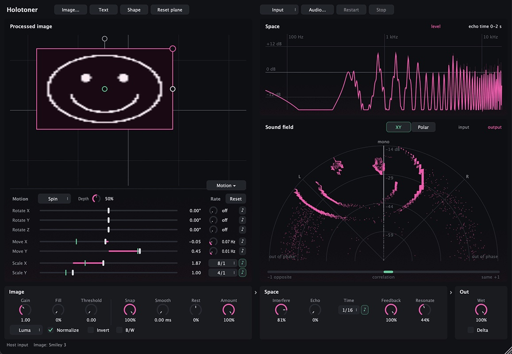

# Holotoner

Holotoner turns an image into a stereo field. Move, scale and rotate the image
plane, and hear the space change. Use an image, text or a generated shape.
Available as Standalone, VST3, AU and a browser application.

See it live: [**https://janne-s.github.io/Holotoner/**](https://janne-s.github.io/Holotoner/)



## How it works

The plane's pose sets stereo position and width. A centred Y rotation of 90°
collapses to mono at full Wet; 180° reverses left and right. Image pixels steer
the sound toward the shape. The polar shows actual input in grey and output in
pink. Its radius follows sample level, with +14 dB display gain.

## Image

- **Image…**, **Text**, **Shape** — Choose the picture. Text can play Whole,
  Characters or Words; Cycle advances at Rate or its ♪ note value. Text and
  its settings apply as you edit them.
  Shape opens the selected generator; Shape and Order changes apply immediately.
  Smiley is the default; its Order sets stroke weight.
- **Plane** — Drag to move. The corner handles rotate and scale; the top handle
  rolls. Double-click resets the pose.
- **Motion** — Rotation X/Y/Z, Move X/Y and Scale X/Y, each with its own Rate
  and ♪. Swing uses Depth; Spin turns rotation axes once per cycle. Motion adds
  to the base values. Green ticks show the moving position. Reset turns every
  Rate and ♪ off and returns Swing and Depth to their defaults; the plane stays.
- **Channel** — Off, Luma, Alpha, Red, Green or Blue.
- **Gain**, **Fill**, **Threshold** — Shape the mask. Fill affects opaque pixels.
  Normalize, Invert and B/W change its contrast.
- **Snap** — How firmly samples follow the image. Lower values soften grit and
  make the figure fainter; try 50–70% for a cleaner sound.
- **Smooth** — Softens sudden image steering (0–5 ms). Zero keeps the original
  sound; longer times blur the figure.
- **Rest** — Turns sound outside the image toward mono (−100%) or the sides
  (+100%). Zero leaves it alone.
- **Amount** — Image influence. Zero or Channel Off removes it.
- **XY | Polar** — Straight placement or a curved projection around the field.

## Space

- **Interfere** — A comb filter set by the plane's pose.
- **Echo** — Frequency-dependent echoes, stronger on bright image rows.
- **Time** — Echo time at the plane centre. ♪ replaces milliseconds with a note
  at the current tempo; tilted rows arrive earlier or later. Maximum delay: 2 s.
- **Feedback** — Echo repeats and Interfere's resonance.
- **Resonate** — Bright rows ring at pitches set by their projected height.

The Space plot shows level and echo time by frequency.

## Out

- **Wet** — Blends processed audio with latency-aligned Dry.
- **Delta** — Plays only the change: processed minus Dry, scaled by Wet.

## Browser

Play the demo or load a local audio file. Save and Open store parameters and
image frames; audio is loaded separately. Media stays on your device.
See [web/README.md](web/README.md) for local use and GitHub Pages.

## Build

macOS, CMake 3.25+, C++20. CMake fetches JUCE 9.0.2.

```sh
cmake -S . -B build/native-release -DCMAKE_BUILD_TYPE=Release
cmake --build build/native-release --parallel
open build/native-release/plugin/Holotoner_artefacts/Release/Standalone/Holotoner.app
```

VST3 and AU are in the same `Release` directory. Copy them to your plug-in
folder to use them in a DAW.

## Tests

```sh
cmake -S . -B build/core-release -DCMAKE_BUILD_TYPE=Release -DHOLOTONER_BUILD_PLUGIN=OFF
cmake --build build/core-release --parallel
ctest --test-dir build/core-release --output-on-failure
```

Native UI and state checks:

```sh
cmake --build build/native-release --target holotoner-native-tests --parallel
build/native-release/tests/holotoner-native-tests
```

## License

Copyright © 2026 Janne Särkelä. [AGPL-3.0-only](LICENSE).
JUCE is available under AGPLv3 or a commercial licence.
